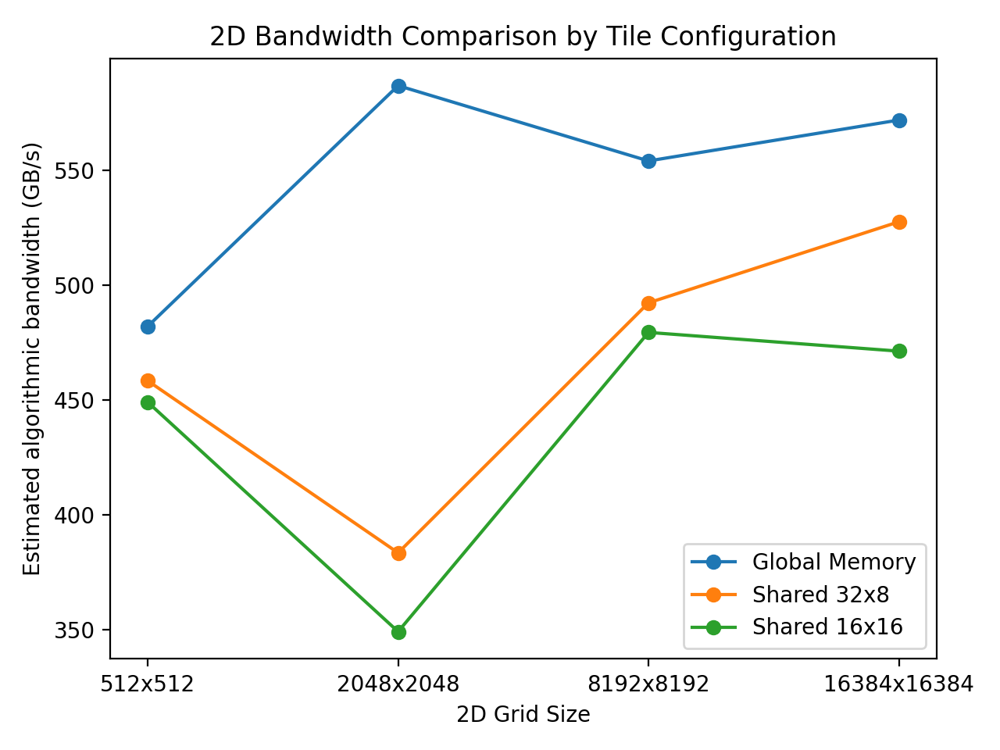
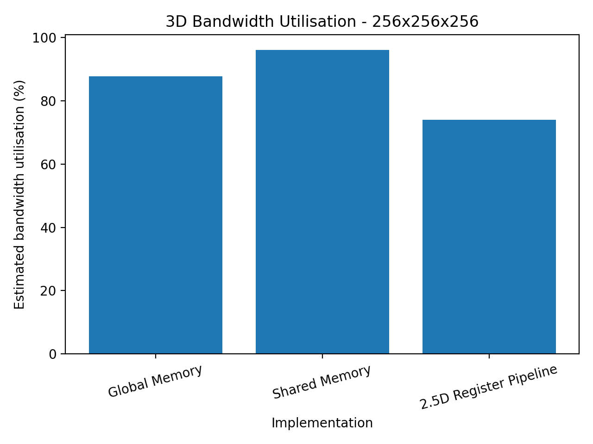
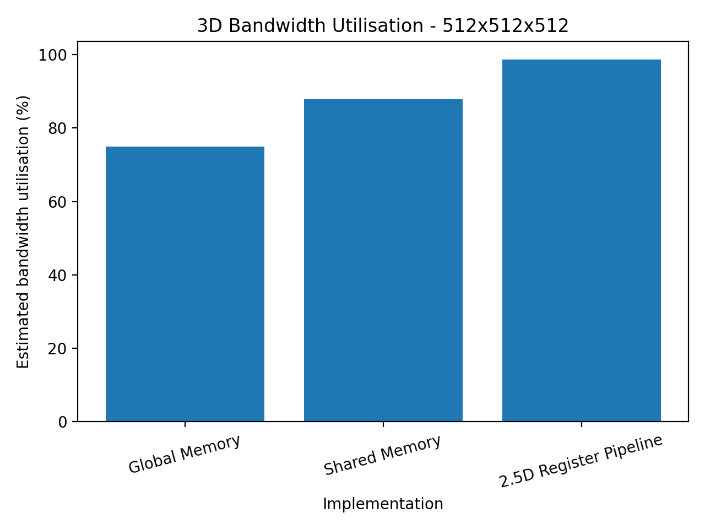
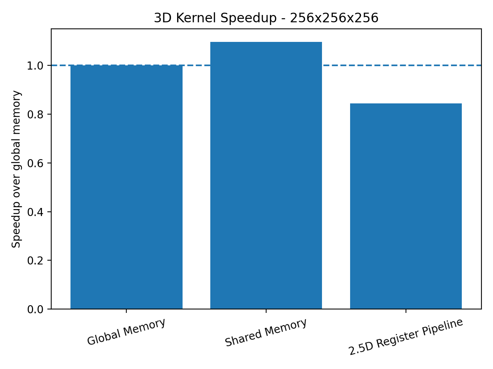
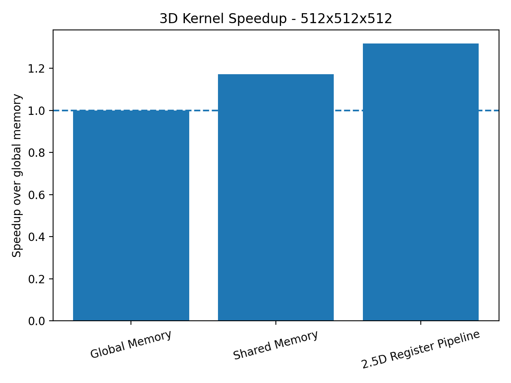

# CUDA-Accelerated 2D and 3D Stencil Computation

### Performance Analysis of Global Memory, Shared Memory and 2.5D Register-Based CUDA Implementations

<p align="center">
  <b>GPU Computing | CUDA | Parallel Programming | Performance Optimization</b>
</p>

---

## 1. Project Overview

This project explores the implementation and performance optimization of
two-dimensional (2D) and three-dimensional (3D) stencil computations using
NVIDIA CUDA.

Stencil computations are fundamental operations in scientific computing,
numerical simulations, image processing, heat diffusion, fluid dynamics
and other high-performance computing applications.

The project implements multiple computational strategies and evaluates
their performance by comparing execution time, data transfer overhead,
estimated memory bandwidth and speedup.

The primary objective is to understand how different GPU memory
architectures and optimization techniques affect the performance of
memory-intensive parallel workloads.

### Implementations explored

- Sequential CPU-based 2D stencil.
- CUDA 2D stencil using global memory.
- CUDA 2D stencil using shared memory.
- CUDA 3D stencil using global memory.
- CUDA 3D stencil using shared memory.
- CUDA 3D stencil using a 2.5D register pipeline.
- Benchmark configurations for 256³ and 512³ grids.

---

## 2. Project Objectives

1. Understand stencil computation and its data dependencies.
2. Implement sequential and parallel stencil algorithms.
3. Explore GPU global memory access patterns.
4. Optimize memory reuse through shared memory.
5. Investigate register-based data reuse using a 2.5D pipeline.
6. Benchmark different implementations across multiple grid sizes.
7. Measure kernel execution time and host-device transfer overhead.
8. Verify GPU outputs against CPU reference results.
9. Analyze performance improvements and memory bandwidth estimates.

---

## 3. Understanding Stencil Computation

A stencil operation calculates the value of a grid element using its
neighbouring elements.

For a 2D five-point stencil, the updated value is calculated using:

\[
A'_{i,j} =
\frac{1}{5}
\left(
A_{i,j} + A_{i-1,j} + A_{i+1,j}
+ A_{i,j-1} + A_{i,j+1}
\right)
\]

For a 3D seven-point stencil:

\[
A'_{i,j,k} =
\frac{1}{7}
\left(
A_{i,j,k} + A_{i-1,j,k} + A_{i+1,j,k}
+ A_{i,j-1,k} + A_{i,j+1,k}
+ A_{i,j,k-1} + A_{i,j,k+1}
\right)
\]

Each output element depends on its neighbouring grid elements.

Boundary elements are handled separately to avoid out-of-bounds memory
accesses.

The computation is repeated for multiple iterations, with the output
of one iteration becoming the input to the next.

---

## 4. CUDA Implementation Approaches

### 4.1 Global Memory Implementation

The baseline CUDA implementation accesses input and output data directly
from GPU global memory.

**Characteristics:**
- Each CUDA thread computes a grid element.
- Neighbouring values are fetched from global memory.
- The implementation provides a straightforward baseline.
- Repeated memory accesses can increase memory traffic.

This implementation serves as the reference for evaluating the
optimized approaches.

### 4.2 Shared Memory Implementation

Shared memory is a fast, on-chip memory space shared by threads within
a CUDA thread block.

The implementation loads the required grid region into shared memory
before performing stencil calculations.

**Characteristics:**
- Cooperative loading of data by threads.
- Reuse of neighbouring values within a block.
- Reduced reliance on repeated global-memory loads.
- Synchronization is required when threads cooperate on shared data.
- Boundary and halo regions must be handled correctly.

The shared-memory approach aims to improve performance by exploiting
data locality.

### 4.3 2.5D Register Pipeline Implementation

The 2.5D register-based approach explores reuse of stencil values through
registers and a pipelined computation strategy.

**Characteristics:**
- Register-based reuse of intermediate values.
- Reduced repeated loading of neighbouring data where reuse is possible.
- Pipelined processing of grid regions.
- Increased implementation complexity.
- Performance depends on register usage, occupancy and memory access
  behaviour.

The approach is evaluated against global-memory and shared-memory
implementations.

---

## 5. Repository Structure

```text
Problem27-CUDA-Stencil/
│
├── src/
│   ├── hello.cu
│   ├── sequential2D.cpp
│   ├── stencil_global_2D.cu
│   ├── stencil_shared_2D.cu
│   ├── stencil_3D.cu
│   ├── stencil_3D_25D.cu
│   ├── stencil_3D_25D_register.cu
│   ├── stencil_3D_global_256.cu
│   ├── stencil_3D_global_512.cu
│   ├── stencil_3D_shared_256.cu
│   ├── stencil_3D_shared_512.cu
│   ├── stencil_3D_25D_register_256.cu
│   ├── stencil_3D_25D_register_512.cu
│   └── Additional timed benchmark variants
│
├── results/
│   ├── 2D_tile_bandwidth.csv
│   ├── 3D_baseline.csv
│   ├── 3D_shared_memory.csv
│   ├── 3D_25D_register.csv
│   ├── 3D_25D_register_256.csv
│   ├── 3D_25D_register_512.csv
│   ├── 3D_comparison_5iter.csv
│   ├── 3D_transfer_comparison.csv
│   ├── 3D_bandwidth_analysis.csv
│   ├── 3D_bandwidth_utilisation.csv
│   └── 3D_speedup.csv
│
├── plots/
│   ├── 2D_tile_bandwidth_comparison.png
│   ├── 3D_bandwidth_256x256x256.png
│   ├── 3D_bandwidth_512x512x512.png
│   ├── 3D_speedup_256x256x256.png
│   └── 3D_speedup_512x512x512.png
│
├── report/
├── README.md
└── .gitignore
```

---

## 6. Experimental Environment

The experiments were conducted using the following environment:

| Component | Configuration |
|---|---|
| Platform | Google Colab |
| GPU | NVIDIA Tesla T4 |
| CUDA Toolkit | CUDA 13.0 |
| Compute Capability | 7.5 |
| Programming Language | C++ / CUDA C++ |
| Compiler | NVIDIA NVCC |
| Benchmarking | CUDA Events and host-side timing |
| Data Analysis | Python, CSV and Matplotlib |

The Tesla T4 has a nominal memory bandwidth specification of approximately
320 GB/s. This value is used only as a theoretical reference in the
bandwidth-estimate analysis.

---

## 7. Benchmark Methodology

The implementations were evaluated using different grid sizes and
execution configurations.

### 2D experiments

The 2D implementations were evaluated using multiple grid dimensions
and shared-memory tile configurations.

### 3D experiments

Three implementations were compared:

1. Global Memory
2. Shared Memory
3. 2.5D Register Pipeline

Two principal grid configurations were used:

- 256 × 256 × 256
- 512 × 512 × 512

The matched comparison used five iterations for each implementation.

### Performance metrics

**Kernel execution time:** Time taken by the GPU kernel to execute.

**Host-to-device transfer time:** Time required to transfer input data
from CPU memory to GPU memory.

**Device-to-host transfer time:** Time required to transfer output data
from GPU memory to CPU memory.

**Total measured time:** Sum of kernel execution and the measured
host-device transfers.

**Speedup:**

\[
\text{Speedup} =
\frac{\text{Baseline Kernel Time}}
{\text{Optimized Kernel Time}}
\]

**Estimated algorithmic bandwidth:**

\[
\text{Bandwidth} =
\frac{\text{Number of Updates} \times 56}
{\text{Kernel Time in Seconds}}
\]

The 56-byte estimate represents six 8-byte neighbour reads and one
8-byte output write per 3D grid update. This is an algorithmic traffic
estimate, not a direct measurement of physical DRAM traffic.

---

## 8. 2D Benchmark Results

The following measurements were obtained over 100 iterations.

| Grid Size | Global Memory (ms) | Shared 32×8 (ms) | Shared 16×16 (ms) |
|---|---:|---:|---:|
| 512 × 512 | 2.1751 | 2.2878 | 2.3352 |
| 2048 × 2048 | 28.5834 | 43.7630 | 48.0687 |
| 8192 × 8192 | 484.4120 | 545.2578 | 559.9173 |
| 16384 × 16384 | 1877.3103 | 2035.0657 | 2278.4568 |

The global-memory implementation was the fastest among the tested 2D
configurations.

This demonstrates that shared-memory tiling does not automatically
guarantee better performance. Data-loading overhead, synchronization,
memory access patterns and hardware characteristics also influence
execution time.

---

## 9. 3D Benchmark Results

The following results use five iterations for each configuration.

### 9.1 Kernel Execution Time

| Grid Size | Implementation | Kernel Time (ms) |
|---|---|---:|
| 256³ | Global Memory | 16.7257 |
| 256³ | Shared Memory | 15.2708 |
| 256³ | 2.5D Register Pipeline | 19.8255 |
| 512³ | Global Memory | 156.707 |
| 512³ | Shared Memory | 133.761 |
| 512³ | 2.5D Register Pipeline | 118.933 |

### 9.2 Speedup Compared with Global Memory

| Grid Size | Implementation | Speedup |
|---|---|---:|
| 256³ | Shared Memory | 1.0953× |
| 256³ | 2.5D Register Pipeline | 0.8436× |
| 512³ | Shared Memory | 1.1715× |
| 512³ | 2.5D Register Pipeline | 1.3176× |

A speedup greater than 1 indicates an improvement over the global-memory
baseline.

The shared-memory implementation performs better for both tested
3D grid sizes. The 2.5D register pipeline performs better than the
baseline at 512³, while it is slower at 256³.

### 9.3 Estimated Algorithmic Bandwidth

| Grid Size | Implementation | Estimated Bandwidth (GB/s) |
|---|---|---:|
| 256³ | Global Memory | 280.86 |
| 256³ | Shared Memory | 307.62 |
| 256³ | 2.5D Register Pipeline | 236.95 |
| 512³ | Global Memory | 239.82 |
| 512³ | Shared Memory | 280.96 |
| 512³ | 2.5D Register Pipeline | 315.98 |

These values are calculated from the assumed algorithmic data traffic.
They should not be interpreted as hardware-counter measurements of
actual DRAM bandwidth.

---

## 10. Performance Visualizations

The following graphs are generated from the benchmark datasets included
in the `results/` directory.

### 10.1 2D Tile Bandwidth Comparison



### 10.2 3D Bandwidth Comparison — 256³



### 10.3 3D Bandwidth Comparison — 512³



### 10.4 3D Speedup Comparison — 256³



### 10.5 3D Speedup Comparison — 512³



---

## 11. Host-Device Data Transfer Analysis

Kernel execution time is only one component of total application
execution time.

The measured transfer and execution times show that host-device data
transfers account for a substantial portion of the total measured time.

For the tested 3D configurations, transfer time contributes approximately
86–89% of the measured total.

This highlights an important GPU optimization principle:

**Optimizing a GPU kernel alone may not provide equivalent improvements
in end-to-end application performance when data transfer overhead is
significant.**

The total measured time in this experiment includes the timed H2D,
kernel and D2H operations. It excludes memory allocation and CPU
reference computation.

---

## 12. Correctness and Verification

Correctness was evaluated by comparing GPU output against CPU reference
results.

The verification process includes:

1. Initialize input data.
2. Execute the CPU reference implementation.
3. Execute the corresponding CUDA implementation.
4. Compare the resulting output arrays.
5. Calculate the maximum absolute error.
6. Report whether verification passed.

For the six matched 256³ and 512³ 3D benchmark configurations,
the recorded maximum absolute error was zero and verification passed.

This confirms that the tested GPU configurations produced outputs
matching their corresponding CPU reference results for the tested data.

---

## 13. Key Observations

- Global memory provides a useful and competitive baseline.
- Shared memory improves the tested 3D kernel execution times.
- The 2.5D register pipeline demonstrates its advantage at the larger
  512³ grid size.
- Optimization performance depends on grid size and implementation
  details.
- Shared memory introduces loading and synchronization overhead.
- Register-based approaches require careful management of register
  resources and occupancy.
- Host-device transfers can dominate total execution time.
- Correctness verification is essential when modifying memory access
  patterns and parallel execution strategies.

---

## 14. Compilation and Execution

A CUDA-compatible NVIDIA GPU and CUDA Toolkit are required.

Check the installed CUDA compiler:

```bash
nvcc --version
```

Check GPU availability:

```bash
nvidia-smi
```

Example compilation of a CUDA source file:

```bash
nvcc -O3 src/stencil_3D_global_256.cu -o stencil
```

Run the generated executable:

```bash
./stencil
```

To compile another implementation, replace the source filename with
the corresponding file from the `src/` directory.

**Note:** The exact compiler options and runtime arguments may vary
between source files. Refer to each source file for its configuration.

---

## 15. Technologies Used

- CUDA C++
- NVIDIA CUDA Toolkit
- C++
- Google Colab
- Python
- CSV-based benchmark analysis
- Matplotlib

---

## 16. Future Scope

Potential directions for further investigation include:

- More systematic CUDA block and tile-size tuning.
- Additional grid dimensions and iteration counts.
- Improved register utilization and occupancy analysis.
- CUDA profiling with Nsight Compute.
- Direct hardware-counter measurements of DRAM traffic.
- Multi-GPU stencil computation.
- Overlapping host-device transfers with computation.
- More extensive comparisons across GPU architectures.

These are possible future extensions and are not claimed as completed
implementations in the current benchmark results.

---

## 17. Authors

**DHRUV GUPTA**

**HITANSH JAIN**

---

## 18. Acknowledgements

This project was developed as part of a GPU computing and CUDA
programming assignment, exploring parallel stencil computation,
GPU memory hierarchy and performance optimization.

---

## 19. Repository

GitHub: https://github.com/explorer2005/Problem27-CUDA-Stencil

For source code, benchmark datasets and visualizations, explore the
`src/`, `results/` and `plots/` directories.

---
